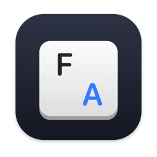
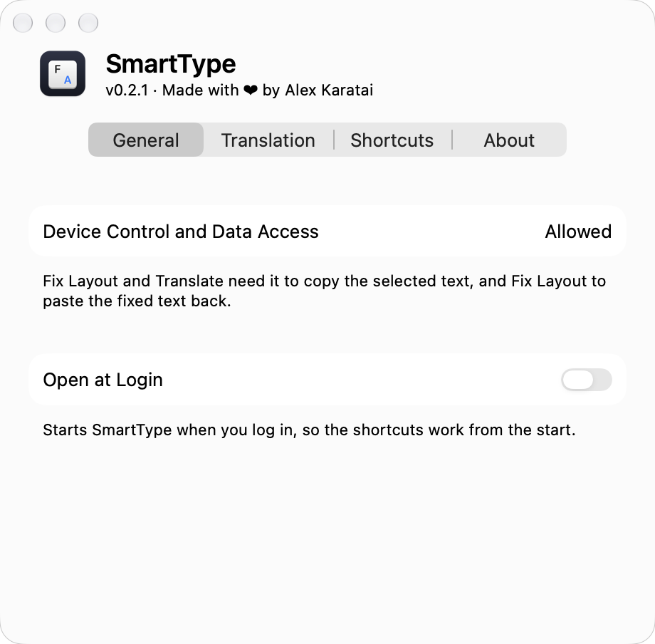

<p align="center">
  
</p>

<h1 align="center">SmartType</h1>

<p align="center">
  <strong>Fix text typed in the wrong keyboard layout. Translate any selection. In every app on your Mac.</strong>
</p>

<p align="center">
  
  
  
  
  
</p>

---

A menu-bar app. Select text anywhere and press a shortcut:

| Shortcut | Command | What happens |
|---|---|---|
| **⌃⌥⇧L** | Fix Layout | `ghbdtn` becomes `привет`, and the keyboard switches to Russian. Works both ways between U.S. and Russian – PC, Shift symbols included. Mixed text is fixed word by word. |
| **⌃⌥⇧T** | Translate | The translation opens in a panel at the pointer. ↩ copies it, Esc closes it. Apple's on-device translation, macOS 26+. |

- **Right-click → Services** has both commands too. From there, Fix Layout replaces the text in place with the app's own undo, and needs neither the clipboard nor any permission.
- **Settings** (⌘, in the menu): your own shortcuts, the translation languages, the Accessibility status, and Open at Login.
- **English and Russian** interface, following the language of macOS.

## 📸 Screenshot

<p align="center">
  
</p>

## 📦 Install

```bash
brew install --cask alexeikaratai/tap/smarttype
```

On first launch, choose **Grant Access…** in SmartType's menu. It restarts and opens **System Settings → Privacy & Security → Accessibility** (**Device Control and Data Access** on macOS 27); switch SmartType on there. The app is ad-hoc signed, so macOS drops this permission after every update, and the same menu item restores it.

Other ways to install:
- **Release zip.** Download it from [Releases](https://github.com/alexeikaratai/smarttype/releases), move `SmartType.app` to `/Applications`, and clear the quarantine flag, since the app is not notarized: `xattr -dr com.apple.quarantine /Applications/SmartType.app`.
- **From source,** with Xcode 26+: `brew install --formula alexeikaratai/tap/smarttype`, or clone the repository and run `make run`.

## 🔒 Privacy

- Your text never leaves the Mac. SmartType makes no network requests, and translation runs on Apple's on-device models.
- Your text is never logged.
- The clipboard is borrowed for the copy and the paste, then given back. Clipboard managers are told to skip what SmartType writes.
- While idle, SmartType does nothing: no timers, no polling, 0% CPU.

## ⚙️ Requirements

| | |
|---|---|
| **Mac** | Apple silicon, macOS 14+. Translate needs macOS 26+. |
| **Accessibility** | Both shortcuts need it to copy the selected text, and Fix Layout to paste the fix back. |
| **Paste from Other Apps** | From macOS 15.4, macOS may ask before SmartType reads what it copied; allow it. |
| **Translation languages** | Download the pair once: System Settings → General → Language & Region → Translation Languages. |

VS Code and other Electron apps have no Services in their right-click menu; the shortcuts work there.

## 🛠️ Development

```bash
git clone https://github.com/alexeikaratai/smarttype.git
cd smarttype
make run      # build, bundle and launch
make help     # every command
```

Needs Xcode 26+. See [CONTRIBUTING.md](CONTRIBUTING.md) for the conventions and checks, [CLAUDE.md](CLAUDE.md) for the design rules, and [CHANGELOG.md](CHANGELOG.md) for what changed.

## 📄 License

MIT © 2026 Alex Karatai. See [LICENSE](LICENSE).
